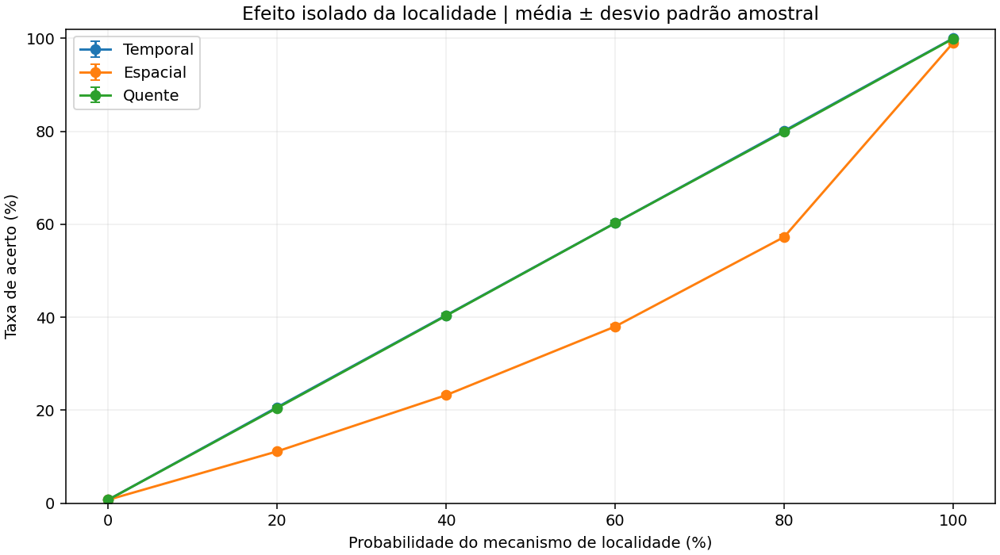

# Atividade 2 — Impacto da localidade temporal, espacial e regiões quentes

Esta atividade varia as probabilidades de `gerar_padrao_realista`, mede a taxa de acerto e correlaciona os resultados com mapas temporais dos acessos. A organização segue o padrão da atividade 6 do grupo. **Nenhum arquivo original da raiz do repositório foi alterado.**

## Configuração executada

- RAM: 1 MiB; cache: 8 KiB; bloco: 16 bytes; associatividade: 16 vias; política: LRU.
- 10.000 acessos por ensaio; 21 cenários; 30 repetições por cenário.
- Sementes inteiras: 20261111 a 20261140. São identificadores, não datas.
- Localidade isolada em 0%, 20%, 40%, 60%, 80% e 100%; cinco cenários mistos.
- Cache inicialmente vazia em cada ensaio; parcela aleatória igual a um menos a soma das probabilidades.
- Mapas: janelas de 50 acessos, IDs reais dos blocos, até 63 mais ativos e contagem explícita dos demais.

Coleta original em 11/11/2026; reprodução da entrega reorganizada em 13/11/2026. Os resultados numéricos foram preservados: **630 execuções e 6.300.000 acessos**. O [relatório](relatorio/atividade_2_impacto_localidade.md) explica metodologia, resultados e limitações.

## Instalação e execução

A partir da raiz do repositório, usando Python 3.12 (versão testada):

```powershell
python -m venv .venv
.\.venv\Scripts\python.exe -m pip install -r atividade-2/requirements.txt
.\.venv\Scripts\python.exe -m unittest discover -s atividade-2/testes -v
.\.venv\Scripts\python.exe atividade-2/scripts/executar_experimentos.py --fase piloto
.\.venv\Scripts\python.exe atividade-2/scripts/executar_experimentos.py --fase completo
.\.venv\Scripts\python.exe atividade-2/scripts/verificar_artefatos.py
```

No Linux/macOS, use `.venv/bin/python`. Não é necessário iniciar a GUI ou instalar seus requisitos. `requirements-lock.txt` registra o ambiente completo utilizado; pode ser usado no lugar de `requirements.txt` para reproduzir as versões exatas. Inclui também pacotes da GUI do ambiente compartilhado da execução, que não são necessários para os scripts.

A fase completa exige piloto aprovado com hashes compatíveis dos scripts e executa os testes antes da simulação. O piloto usa três repetições por cenário. Os comandos regeneram os arquivos da respectiva fase; faça cópia prévia se quiser preservar uma execução anterior. O `.gitignore` da atividade exclui os gráficos e traces redundantes do piloto, mas preserva suas tabelas e evidências.

Para apenas regenerar as figuras dos CSVs definitivos, sem repetir simulações:

```powershell
.\.venv\Scripts\python.exe atividade-2/scripts/gerar_graficos.py
.\.venv\Scripts\python.exe atividade-2/scripts/gerar_mapas_calor.py
```

## Organização

| Pasta/arquivo | Conteúdo |
|---|---|
| `scripts/cache_core.py` | Cache e gerador independentes da interface, com validações |
| `scripts/configuracao.py` | Hardware fixo e definição dos 21 cenários |
| `scripts/executar_experimentos.py` | Piloto, coleta, estatística e validação |
| `scripts/visualizacoes.py` | Renderização compartilhada e leitura dos traces salvos |
| `scripts/gerar_graficos.py` | Regeneração dos três gráficos |
| `scripts/gerar_mapas_calor.py` | Regeneração do painel e dos 21 mapas individuais |
| `scripts/verificar_artefatos.py` | Auditoria de médias, desvios, hashes e replay |
| `resultados/completo/` | 630 resultados, resumo, metadados, testes, validação e auditoria |
| `resultados/completo/traces/` | Primeira repetição de cada cenário, com endereço, bloco e hit/miss |
| `resultados/piloto/` | Evidências dos 63 ensaios de aprovação |
| `graficos/` | Curvas de localidade, comparação das misturas e endereços no tempo |
| `mapas_calor/` | Painel comparativo e um mapa por cenário |
| `testes/` | 15 testes, incluindo equivalência com o código original |
| `relatorio/` | Relatório acadêmico em Markdown |
| `documentacao/` | Registro de execução e guia do commit |

## Principais resultados

| Cenário | Média da taxa de acerto |
|---|---:|
| Aleatório | 0,755% |
| Temporal 100% | 99,990% |
| Espacial 100% | 99,018% |
| Quente 100% | 99,910% |
| Configuração original (20/20/40%) | 76,261% |



## Mapas e preservação do simulador original

O método da GUI gera um trace independente e usa módulo 64 para representar os blocos. A atividade gera seus próprios mapas headless para usar a mesma sequência medida, evitar sobreposição de blocos distantes e preservar a última janela parcial. O método original não foi editado.

As cores dos mapas usam escala comum de 1 a 50 acessos por janela, em escala logarítmica. A parcela `Outros` é informada no título e fica fora das cores de um bloco individual. Os IDs selecionados não definem distâncias físicas entre linhas; o gráfico de endereços no tempo preserva a escala física.

Para commitar, copie **somente `atividade-2/`** para a raiz do clone do grupo, ao lado de `atividade-6/`. Veja o [guia do commit](documentacao/GUIA_DO_COMMIT.md).
