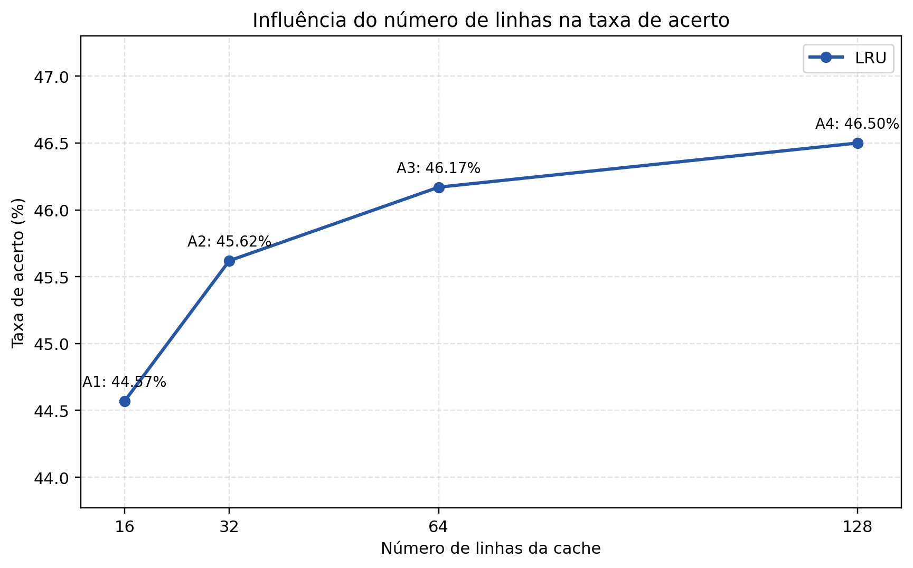
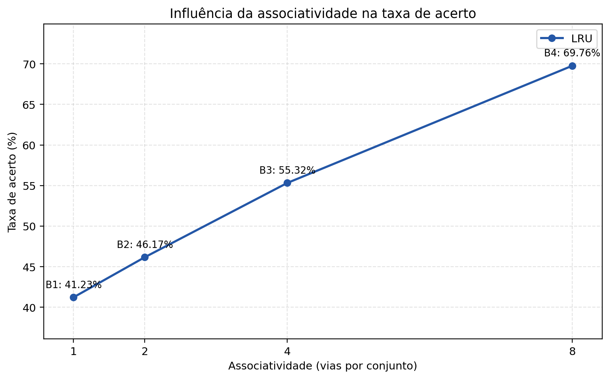
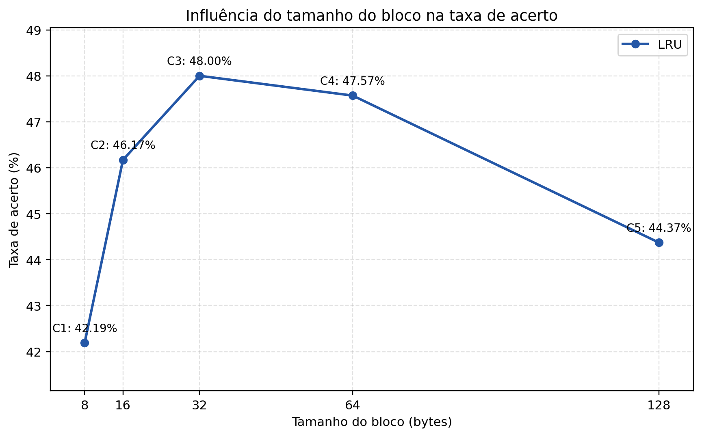

# Atividade 4 — Influência dos Parâmetros da Memória Cache

**Disciplina:** Organização de Computadores — POLI/UPE  
**Professor:** José Paulo G. de Oliveira  
**Simulador:** branch `Versão-2026`, commit `7f37539`  
**Data da execução:** 11 de novembro de 2026

## 1. Introdução

A diferença de velocidade entre processadores e memória principal torna
necessária uma hierarquia de memória. A cache ocupa um nível pequeno e rápido
próximo ao processador e mantém cópias de blocos recentemente utilizados. Seu
desempenho depende não apenas da capacidade total, mas também da forma como os
blocos são organizados e mapeados.

Essa abordagem segue a apresentação de memória cache fornecida pelo professor,
que destaca a cache como um armazenamento rápido entre processador e memória
principal e relaciona seu funcionamento ao princípio da localidade de
referência [1].

Esta atividade investiga três parâmetros arquiteturais: número de linhas, grau
de associatividade e tamanho do bloco. Foram executados treze cenários sobre a
mesma sequência reprodutível de 10.000 endereços. A comparação usa taxa de
acerto e quantidade de misses, relacionando os resultados a capacidade,
conflitos de mapeamento e localidades temporal e espacial.

## 2. Fundamentação teórica

A cache armazena blocos trazidos da memória principal. Cada posição física de
armazenamento é uma linha da cache; além dos dados, a linha possui metadados,
como bit de validade, tag e informações usadas pela política de substituição.
No simulador, cada endereço é decomposto em deslocamento dentro do bloco,
índice do conjunto e tag. O deslocamento seleciona um byte do bloco, o índice
seleciona um conjunto e a tag identifica qual bloco da memória está presente.
Essa terminologia — bloco, linha, rótulo e palavra dentro do bloco — é a usada
no material teórico [1].

Um **cache hit** ocorre quando a linha procurada está válida e sua tag coincide
com a do endereço. Caso contrário, ocorre um **cache miss**, o bloco é inserido
e, se todas as vias do conjunto estiverem ocupadas, uma linha é substituída.
Para uma execução com (N) acessos:

\[
\text{taxa de acerto} = \frac{hits}{N}\times 100\%, \qquad
\text{taxa de erro} = \frac{misses}{N}\times 100\%.
\]

No **mapeamento direto**, cada bloco da RAM pode ocupar apenas uma linha,
determinada pelo índice. Essa organização equivale a um conjunto por linha e
uma via por conjunto. Blocos diferentes que produzem o mesmo índice expulsam
um ao outro, mesmo que existam linhas livres em outros conjuntos, originando
misses de conflito.

No **mapeamento associativo por conjunto**, cada bloco ainda é direcionado a um
conjunto, mas pode ocupar qualquer uma de suas vias. Para L linhas e
associatividade A, o número de conjuntos é L/A. A associatividade maior
oferece mais alternativas de colocação e pode reduzir conflitos, embora exija
comparar mais tags e não elimine misses compulsórios ou de capacidade. Quando
uma substituição é necessária, o LRU escolhe a linha não utilizada há mais
tempo. O código original também preserva FIFO, LFU e Random, mas elas não são
variáveis desta atividade.

No material teórico, o mapeamento associativo por conjuntos é apresentado como
uma solução intermediária: com uma via por conjunto obtém-se o mapeamento direto;
com um único conjunto obtém-se o associativo completo. A relação entre número
total de linhas, vias e conjuntos usada neste relatório é, portanto,
L = A × conjuntos [1].

A utilidade da cache decorre da **localidade temporal**, tendência de reutilizar
endereços acessados recentemente, e da **localidade espacial**, tendência de
acessar endereços próximos. Mais linhas aumentam a capacidade e podem manter
um conjunto de trabalho maior. Blocos maiores podem aproveitar localidade
espacial, mas, sob capacidade fixa, reduzem o número de linhas e podem trazer
bytes não utilizados. Associatividade maior tende a combater conflitos, mas o
benefício depende da distribuição dos endereços entre conjuntos. Portanto,
nenhum parâmetro deve ser avaliado isoladamente da carga.

## 3. Metodologia

### 3.1 Simulador e execução headless

Foi usado o commit `7f37539`, que é simultaneamente a ponta local de
`projeto-2026`, `origin/projeto-2026` e `origin/Versão-2026`. O núcleo original
define `CacheLine`, `CacheSet`, `CacheMemory`, as quatro políticas e
`gerar_padrao_realista` no mesmo arquivo da GUI. Como esse arquivo força o
backend Tk e importa `customtkinter`, foi criado um módulo headless independente
que reproduz a lógica da cache e do gerador. Não houve alteração do arquivo
original nem das políticas.

A metodologia segue diretamente a Atividade 4 do documento do projeto: fixar o
padrão de acesso e a política de substituição e variar individualmente o número
de linhas, a associatividade e o tamanho do bloco [2]. O README do simulador
identifica essas mesmas variáveis, as classes `CacheMemory`, `CacheSet` e
`CacheLine`, e a taxa de acerto como métrica de saída [3].

O estado aleatório global foi substituído, somente no módulo experimental, por
uma instância local de `random.Random`. Isso permite fixar a semente sem mudar
a distribuição da carga. Foram usados Python 3.12.3, biblioteca padrão e
Matplotlib 3.6.3 com backend não interativo `Agg`.

### 3.2 Carga e variáveis controladas

A RAM possui 1.048.576 B (1 MiB), a política é LRU, são feitos 10.000 acessos e
a semente é 2026. O padrão realista conserva os parâmetros da interface:
probabilidade temporal 0,20; espacial 0,20; regiões quentes 0,40; e acesso
aleatório no restante 0,20. O deslocamento espacial varia de -16 a +16 bytes e
o acesso a uma região quente usa deslocamento de 0 a 3 bytes.

A sequência foi gerada uma vez e reutilizada. Como todos os experimentos têm a
mesma RAM, quantidade de acessos, probabilidades, regiões e semente, os treze
cenários receberam exatamente a mesma lista de endereços. Em cada experimento,
apenas a variável investigada foi alterada.

### 3.3 Validação e reprodutibilidade

As configurações foram verificadas antes da simulação: tamanhos e
associatividade positivos e potências de dois; cache menor que a RAM; bloco não
maior que a cache; número inteiro de linhas; e número de conjuntos positivo e
potência de dois. Esta última condição é necessária porque o simulador calcula
índice com quantidade inteira de bits. Todos os cenários propostos foram
aceitos sem ajuste.

Após cada cenário foram verificadas as identidades (hits+misses=10.000),
(linhas=capacidade/bloco), (conjuntos=linhas/associatividade) e
(hit\ rate+miss\ rate=100\%\). Os resultados foram gravados em CSV com seis
casas decimais. Os testes automatizados cobrem parâmetros inválidos, cálculos
estruturais, uma sequência conhecida de hits e misses, repetição da carga com
semente fixa e integridade do CSV.

## 4. Experimento A — Número de linhas

O experimento A avalia o aumento da capacidade por meio do número de linhas.
Foram mantidos bloco de 16 B, associatividade de 2 vias e LRU. A capacidade
obedece a (capacidade=linhas\times bloco\).

| Cenário | Cache | Linhas | Bloco | Vias | Conjuntos | Hits | Misses | Hit rate | Miss rate |
|---|---:|---:|---:|---:|---:|---:|---:|---:|---:|
| A1 | 256 B | 16 | 16 B | 2 | 8 | 4.457 | 5.543 | 44,57% | 55,43% |
| A2 | 512 B | 32 | 16 B | 2 | 16 | 4.562 | 5.438 | 45,62% | 54,38% |
| A3 | 1.024 B | 64 | 16 B | 2 | 32 | 4.617 | 5.383 | 46,17% | 53,83% |
| A4 | 2.048 B | 128 | 16 B | 2 | 64 | 4.650 | 5.350 | 46,50% | 53,50% |

A taxa de acerto cresceu em todos os aumentos de capacidade, de 44,57% para
46,50%, e o total de misses caiu em 193. Entretanto, os ganhos por duplicação
foram 1,05, 0,55 e 0,33 ponto percentual. A sequência apresenta, portanto,
retorno progressivamente menor nesse intervalo. Linhas adicionais retiveram
mais blocos e reduziram misses de capacidade e alguns conflitos pela ampliação
do número de conjuntos, mas uma parcela importante dos acessos continuou sendo
compulsória, aleatória ou sujeita a conflitos que duas vias não absorveram.

## 5. Experimento B — Associatividade

O experimento B mantém cache de 1 KiB, bloco de 16 B, 64 linhas e LRU. Ao elevar
a associatividade, a capacidade permanece constante, enquanto o número de
conjuntos diminui.

| Cenário | Cache | Linhas | Bloco | Vias | Conjuntos | Hits | Misses | Hit rate | Miss rate |
|---|---:|---:|---:|---:|---:|---:|---:|---:|---:|
| B1 | 1.024 B | 64 | 16 B | 1 | 64 | 4.123 | 5.877 | 41,23% | 58,77% |
| B2 | 1.024 B | 64 | 16 B | 2 | 32 | 4.617 | 5.383 | 46,17% | 53,83% |
| B3 | 1.024 B | 64 | 16 B | 4 | 16 | 5.532 | 4.468 | 55,32% | 44,68% |
| B4 | 1.024 B | 64 | 16 B | 8 | 8 | 6.976 | 3.024 | 69,76% | 30,24% |

O mapeamento direto obteve a menor taxa, 41,23%. Duas, quatro e oito vias
elevaram o resultado em 4,94, 14,09 e 28,53 pontos percentuais em relação a B1.
A magnitude está ligada à carga utilizada: com blocos de 16 B, diversas bases
das regiões quentes são múltiplas que produzem o mesmo índice em configurações
com poucos caminhos de colocação. No mapeamento direto, esses blocos se
substituem repetidamente; vias adicionais permitem sua coexistência no
conjunto e o LRU preserva os mais recentes.

Esse resultado não significa que associatividade sempre produza ganhos dessa
ordem. Uma sequência uniformemente distribuída ou sem colisões frequentes pode
mostrar pouca diferença, e maior associatividade tem custos de hardware que o
simulador não modela. Aqui, porém, o aumento foi efetivo porque os conflitos da
carga eram dominantes.

## 6. Experimento C — Tamanho do bloco

O experimento C mantém cache de 1 KiB, duas vias e LRU. Como a capacidade é
fixa, dobrar o bloco reduz à metade tanto o número de linhas quanto o número de
conjuntos.

| Cenário | Cache | Linhas | Bloco | Vias | Conjuntos | Hits | Misses | Hit rate | Miss rate |
|---|---:|---:|---:|---:|---:|---:|---:|---:|---:|
| C1 | 1.024 B | 128 | 8 B | 2 | 64 | 4.219 | 5.781 | 42,19% | 57,81% |
| C2 | 1.024 B | 64 | 16 B | 2 | 32 | 4.617 | 5.383 | 46,17% | 53,83% |
| C3 | 1.024 B | 32 | 32 B | 2 | 16 | 4.800 | 5.200 | 48,00% | 52,00% |
| C4 | 1.024 B | 16 | 64 B | 2 | 8 | 4.757 | 5.243 | 47,57% | 52,43% |
| C5 | 1.024 B | 8 | 128 B | 2 | 4 | 4.437 | 5.563 | 44,37% | 55,63% |

O aumento de 8 B para 16 B e 32 B elevou a taxa de 42,19% para 46,17% e 48,00%.
O gerador acessa vizinhos em uma faixa de ±16 bytes e usa pequenos
deslocamentos nas regiões quentes; blocos intermediários conseguem atender
parte desses acessos espaciais após um miss inicial. O melhor resultado medido
foi C3, com 32 B.

Blocos maiores não mantiveram a melhoria. Em 64 B a taxa caiu levemente para
47,57%; em 128 B caiu para 44,37%. Nessas configurações restam apenas 16 e 8
linhas. A perda de diversidade de blocos residentes, os conflitos em 8 e 4
conjuntos e a ocupação por bytes possivelmente não utilizados superaram o ganho
espacial. O valor de 32 B é o melhor apenas para esta carga e esta capacidade,
não um tamanho universalmente ideal.

## 7. Discussão geral

Os três experimentos isolam mecanismos diferentes. Em A, acrescentar linhas
simultaneamente aumentou capacidade e quantidade de conjuntos; houve redução
consistente de misses, mas com ganhos marginais decrescentes. Em B, as mesmas
64 linhas foram reorganizadas: mais vias reduziram fortemente conflitos
provocados pelo alinhamento das regiões quentes. Em C, o tamanho do bloco
produziu uma troca: até 32 B, a localidade espacial trouxe vantagem; depois,
a queda no número de linhas e conjuntos passou a prejudicar a taxa.

A comparação A3, B2 e C2 também serve como controle interno: os três descrevem
a mesma cache de 1 KiB, bloco de 16 B, duas vias e 32 conjuntos e produziram
exatamente 4.617 hits e 5.383 misses. Essa igualdade confirma que os scripts
usaram a mesma carga e que os parâmetros equivalentes foram tratados de forma
consistente.

Os números representam taxa de acerto, não tempo médio de acesso. O modelo não
inclui latência de hit, penalidade de miss, largura de banda, energia, escrita
ou custo de comparadores. Consequentemente, os resultados permitem discutir o
comportamento lógico da cache, mas não estimar diretamente o desempenho total
de um processador real.

## 8. Conclusão

Na sequência testada, aumentar a cache de 256 B para 2 KiB elevou a taxa de
44,57% para 46,50%, com ganhos menores a cada duplicação. Manter 1 KiB e elevar
a associatividade de uma para oito vias produziu a maior variação, de 41,23%
para 69,76%, devido à redução de conflitos entre endereços quentes. Com 1 KiB e
duas vias, blocos de 32 B atingiram a maior taxa observada, 48,00%; blocos de 64
e 128 B perderam desempenho porque reduziram a quantidade de linhas e
conjuntos.

Essas observações sustentam que capacidade, flexibilidade de mapeamento e
localidade espacial interagem. O melhor ajuste depende da distribuição dos
acessos e das limitações de implementação; os dados não justificam um tamanho
de bloco ou grau de associatividade universalmente ideal.

## 9. Referências

1. OLIVEIRA, José Paulo G. de. **Memória cache — seção 4.10 de Sistemas
   Computacionais e Sistemas Embarcados de Tempo Real**. PDF disponibilizado
   pelo professor: `Memória cache - teoria.pdf`, 2025.
2. OLIVEIRA, José Paulo G. de. **Projeto — Simulador cache**. PDF de atividades
   da disciplina, seção 4 — “Influência dos Parâmetros da Cache”.
3. OLIVEIRA, José Paulo G. de. **README — Simulador de Memória Cache**. PDF
   disponibilizado pelo professor: `README_Simulador_Memoria_Cache.pdf`.
4. OLIVEIRA, José Paulo G. de. **Simulador de Memória Cache**, branch
   `Versão-2026`, commit `7f37539`. Repositório GitHub. Disponível em:
   <https://github.com/jpauloo-git/simulador_cache/tree/Vers%C3%A3o-2026>.
   Acesso em: 11 nov. 2026.
5. OLIVEIRA, José Paulo G. de. **Código-fonte do simulador**. Arquivo
   `cache_simulator_GUI.py` do mesmo repositório e commit.
