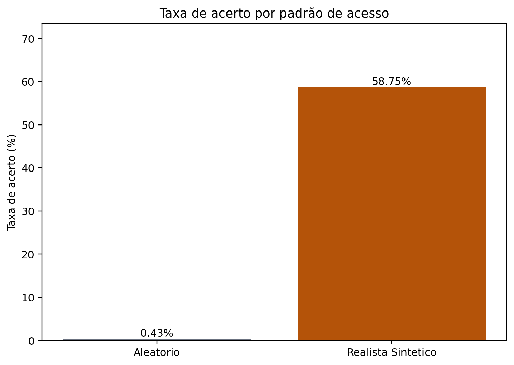
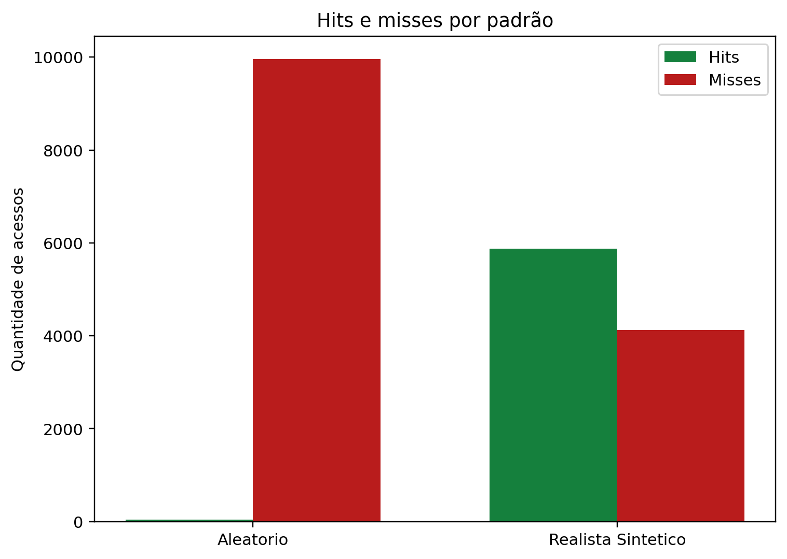
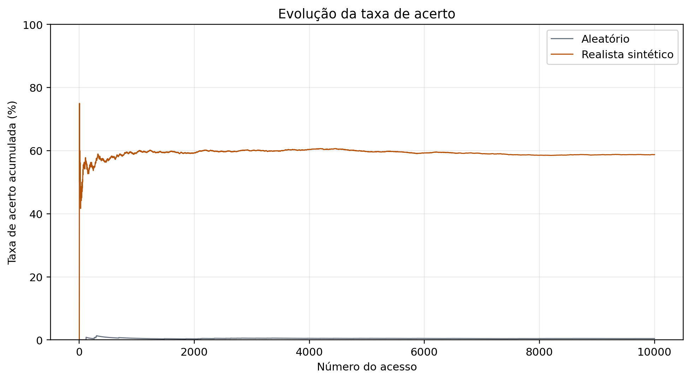
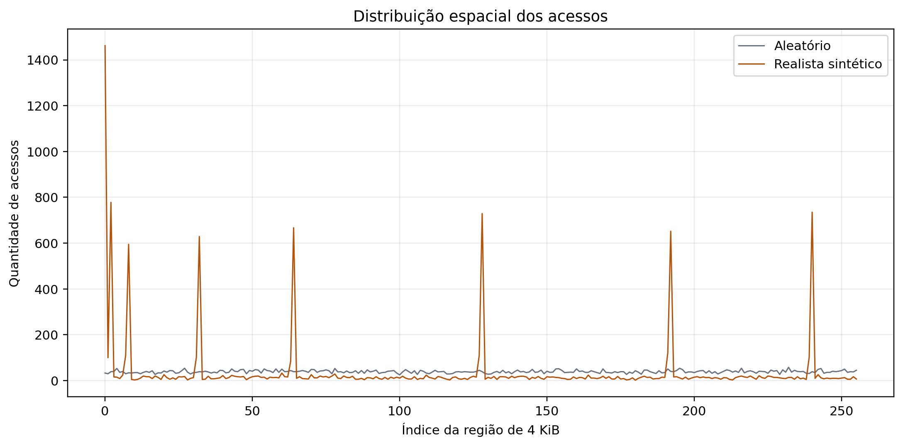
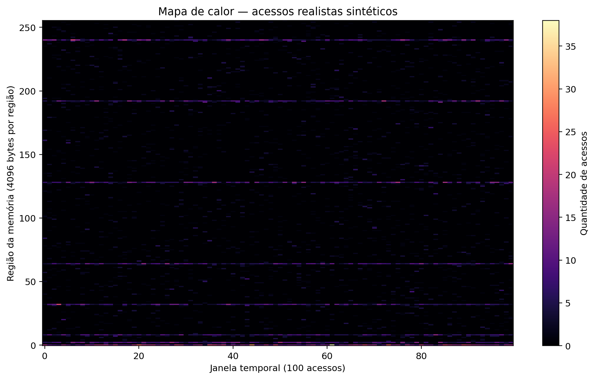

# Atividade 6 — Estudo de casos: acesso realista versus aleatório

**Disciplina:** Organização de Computadores — POLI/UPE  
**Professor:** José Paulo G. de Oliveira  
**Base:** branch `Versão-2026`, commit `7f37539`  
**Data da execução:** 11 de novembro de 2026

## 1. Introdução

A memória cache reduz o tempo médio de acesso ao manter, próximo ao processador,
cópias de blocos recentemente utilizados da memória principal. Entretanto, o
benefício não depende somente da capacidade da cache: depende também da forma
como os endereços são solicitados. Programas frequentemente exibem localidade,
enquanto uma sequência uniforme e aleatória tende a dispersar os acessos.

A Atividade 6 proposta no documento do projeto solicita comparar um padrão
completamente aleatório com um padrão realista, observar a taxa de acerto e
utilizar mapas de calor para relacionar desempenho e distribuição dos acessos
[2]. O objetivo deste estudo é medir essa diferença sob hardware e política de
substituição constantes, sem confundir padrão de acesso com a política Random.

## 2. Fundamentação teórica

### 2.1 Cache, hits e misses

O material teórico descreve a cache como uma memória pequena e rápida entre o
processador e a memória principal [1]. A transferência ocorre em blocos: um
bloco da memória principal ocupa uma linha da cache. Em uma solicitação, ocorre
**cache hit** quando o bloco correspondente está válido na cache; caso contrário,
ocorre **cache miss**, e o bloco precisa ser buscado na memória principal [1].

Para (N) acessos, as métricas usadas são:

\[
\text{hit rate} = \frac{hits}{N}\times 100\%, \qquad
\text{miss rate} = \frac{misses}{N}\times 100\%.
\]

O simulador representa a cache por `CacheMemory`, `CacheSet` e `CacheLine`,
calcula o conjunto a partir do índice do endereço e contabiliza hits e misses
durante `request_access` [3]. Neste experimento, a cache possui 4 KiB, blocos de
32 bytes e quatro vias: são 128 linhas e 32 conjuntos.

### 2.2 Localidade e padrões de acesso

O princípio da localidade de referência possui duas formas principais. A
**localidade temporal** ocorre quando um endereço acessado recentemente tende a
ser acessado novamente. A **localidade espacial** ocorre quando endereços
próximos do endereço atual tendem a ser acessados em seguida [1]. Regiões
quentes são áreas da memória escolhidas com frequência maior que o restante.

Uma carga completamente aleatória não impõe repetição, vizinhança ou
concentração: cada endereço é escolhido uniformemente no intervalo da RAM. Uma
carga realista, por outro lado, pode ser sintética e ainda assim incorporar
características de programas reais. A função `gerar_padrao_realista` do
simulador combina repetição do endereço anterior, deslocamento entre -16 e +16
bytes, escolha de regiões quentes com deslocamento de 0 a 3 bytes e acessos
aleatórios residuais [3]. Portanto, “realista” neste relatório não significa
rastro coletado de uma aplicação; significa um modelo probabilístico de
localidade.

Quando há localidade, um bloco trazido após um miss pode atender solicitações
seguintes do mesmo bloco ou de blocos próximos. A política LRU também tende a
preservar os blocos recentemente reutilizados. Em uma carga uniforme e aleatória,
as reutilizações são menos frequentes e a capacidade limitada da cache não
consegue manter a maioria dos blocos solicitados.

## 3. Metodologia

### 3.1 Base e implementação

Foi utilizada a base `Versão-2026` no commit `7f37539`. O núcleo experimental é
headless e reproduz as classes e políticas do arquivo original, sem alterar o
mapeamento ou as políticas FIFO, LRU, LFU e Random. A política dos dois cenários
é LRU. A equivalência do resultado LRU com o núcleo original foi verificada por
teste automatizado.

O README do projeto confirma que o simulador expõe tamanho da RAM, tamanho da
cache, bloco, associatividade, política, padrão de acesso, localidade e hit rate
como variáveis experimentais [3]. A Atividade 6 do documento do projeto orienta
comparar o padrão aleatório e o padrão “realista” e usar o mapa temporal de
blocos para justificar a diferença [2].

### 3.2 Parâmetros

| Parâmetro | Valor |
|---|---:|
| Memória principal | 1.048.576 bytes (1 MiB) |
| Cache | 4.096 bytes (4 KiB) |
| Tamanho do bloco | 32 bytes |
| Associatividade | 4 vias |
| Linhas / conjuntos | 128 / 32 |
| Política | LRU |
| Acessos por cenário | 10.000 |
| Semente | 42 |
| Janela temporal | 100 acessos |
| Região espacial do mapa | 4.096 bytes |

O cenário aleatório usa uma instância local de `random.Random(42)` e escolhe
cada endereço com `randint(0, 1048575)`. O cenário realista usa a mesma semente,
RAM e quantidade de acessos, com probabilidades temporal 0,20, espacial 0,20 e
regiões quentes 0,40; os 0,20 restantes são aleatórios. As regiões quentes são
as posições definidas no simulador original: 64, 1.024, 8.192, 32.768,
131.072, 262.144, 524.288, 786.432 e 983.040.

### 3.3 Procedimento e mapas

Cada sequência foi gerada uma vez, registrada em CSV e executada na mesma
configuração de cache. Foram armazenados endereço, bloco de 32 bytes, janela
temporal e região de 4 KiB. Os mapas têm 100 colunas temporais e 256 linhas
espaciais. Assim, cada célula representa a quantidade de acessos em uma região
de 4 KiB durante 100 solicitações.

Os dois mapas usam `imshow` com a mesma escala `vmin=0` e `vmax` comum, obtido do
maior valor entre as duas matrizes. Essa escolha impede que uma escala diferente
faça os cenários parecerem mais ou menos concentrados artificialmente. A
agregação em 4 KiB reduz 32.768 blocos da RAM a 256 regiões, mas é aplicada de
forma idêntica às duas cargas e é explicitada nos eixos.

O método gráfico original depende de uma janela Tk e de `FigureCanvasTkAgg`.
Além disso, sua divisão inteira por 50 pode produzir zero janelas quando a
carga tem menos de 50 acessos. Para não reconstruir a interface, os mapas desta
atividade foram gerados independentemente com Matplotlib `Agg`. Não foi
necessária alteração do arquivo original; a integração gráfica não foi testada
porque o ambiente de execução não oferece display.

## 4. Experimento A — Acessos aleatórios

Foram gerados 10.000 endereços uniformes entre 0 e 1.048.575. Não há regra de
repetição do endereço anterior, deslocamento para vizinhos ou seleção de
regiões quentes. A semente 42 torna a sequência reproduzível.

| Cenário | Hits | Misses | Hit rate | Miss rate | Blocos distintos | Regiões distintas |
|---|---:|---:|---:|---:|---:|---:|
| A — aleatório | 43 | 9.957 | 0,43% | 99,57% | 8.618 | 256 |

Com 128 linhas de 32 bytes, a cache contém apenas 128 dos 32.768 blocos da RAM.
Como a sequência visitou 8.618 blocos distintos e não repetiu o endereço
imediatamente anterior, quase todas as solicitações encontraram blocos ausentes.
Os 43 hits observados são compatíveis com reutilizações ocasionais dentro da
sequência uniforme, não com uma localidade imposta pelo gerador.

O mapa aleatório apresenta pontos dispersos ao longo das 256 regiões e das 100
janelas. Não há linhas horizontais persistentes associadas a regiões quentes;
a pequena variação de intensidade decorre da própria amostragem aleatória.

## 5. Experimento B — Acessos realistas sintéticos

O segundo cenário utilizou a função realista existente, com as probabilidades
registradas na Tabela de parâmetros. A primeira escolha do gerador também é
aleatória, mas os acessos seguintes podem repetir o endereço anterior, visitar
vizinhos ou concentrar-se nas regiões quentes.

| Cenário | Hits | Misses | Hit rate | Miss rate | Blocos distintos | Regiões distintas |
|---|---:|---:|---:|---:|---:|---:|
| B — realista sintético | 5.875 | 4.125 | 58,75% | 41,25% | 2.013 | 256 |

O cenário realista obteve 5.875 hits. Em 9.999 transições entre acessos,
2.262 repetiram exatamente o endereço anterior (22,62%) e 4.361 permaneceram
numa distância de até 16 bytes (43,61%). A sequência visitou 2.013 blocos
distintos, menos de um quarto da quantidade do cenário aleatório.

O mapa exibe faixas horizontais persistentes nas regiões quentes e atividade
mais intensa em várias janelas. A distribuição espacial possui picos muito
maiores que a linha aleatória: a região 0 recebeu 1.462 acessos, enquanto a
maior contagem aleatória em uma região foi 58. Esses picos são dados gerados
pelo modelo, não uma captura de programa real.

## 6. Comparação dos resultados

| Métrica | Aleatório | Realista sintético | Diferença (realista − aleatório) |
|---|---:|---:|---:|
| Hits | 43 | 5.875 | +5.832 |
| Misses | 9.957 | 4.125 | −5.832 |
| Hit rate | 0,43% | 58,75% | +58,32 pontos percentuais |
| Miss rate | 99,57% | 41,25% | −58,32 pontos percentuais |
| Blocos distintos | 8.618 | 2.013 | −6.605 |
| Repetição do endereço anterior | 0,00% | 22,62% | +22,62 p.p. |

As configurações de hardware são idênticas; portanto, a diferença observada é
atribuída ao padrão de endereços, e não à capacidade ou à política de
substituição. A carga realista apresentou taxa de acerto 136,6 vezes maior que
a aleatória (razão numérica entre as taxas, com o denominador não nulo). Mais
importante que a razão, os mapas e os registros mostram o mecanismo: repetição,
proximidade e concentração mantêm blocos úteis na cache.

Os mapas devem ser interpretados junto com a granularidade de 4 KiB. Uma faixa
horizontal significa muitos acessos à mesma região agregada; não significa que
todos os 128 blocos daquela região estejam simultaneamente na cache. A taxa de
acerto foi calculada no nível de blocos de 32 bytes, enquanto o mapa foi
agregado apenas para visualização.

## 7. Discussão

Padrões com localidade beneficiam a cache porque a transferência de um bloco
atende mais de uma solicitação e porque LRU mantém dados recentemente usados.
No cenário realista, as repetições temporais e os deslocamentos pequenos
reduziram a variedade efetiva de blocos; as regiões quentes reforçaram ainda
mais essa reutilização. No aleatório, a dispersão fez com que a cache de 128
linhas representasse uma fração muito pequena do conjunto de 32.768 blocos da
RAM.

Os mapas de calor ajudam a explicar a métrica, mas não substituem o registro de
acessos nem o contador de hits. A mesma concentração poderia parecer diferente
se cada cenário usasse uma escala de cores própria; por isso a normalização foi
comum. Também não se deve concluir que toda carga “realista” terá 58,75% de
acerto: o valor depende das probabilidades, regiões, tamanho da cache, bloco,
associatividade, política e semente.

As cargas são sintéticas. Elas não representam instruções, endereços ou fases
de um programa específico e não substituem rastros reais. Além disso, o
simulador mede apenas hits e misses; não modela latência, custo de transferência,
energia, escrita ou pré-busca. Benchmark representativo deve, portanto, ser
escolhido de acordo com a aplicação que se deseja estudar.

## 8. Conclusão

Sob a configuração de 1 MiB de RAM, cache de 4 KiB, bloco de 32 bytes, quatro
vias e LRU, o acesso uniforme aleatório produziu 43 hits em 10.000 acessos
(0,43%). A carga realista sintética, com as probabilidades do gerador original,
produziu 5.875 hits (58,75%).

O padrão realista visitou menos blocos, repetiu endereços e concentrou acessos
em regiões quentes. Essas características aparecem como faixas e picos nos
mapas de calor e explicam a redução de misses. A comparação sustenta a
importância de benchmarks representativos: alterar apenas o comportamento dos
acessos mudou substancialmente o desempenho medido da mesma arquitetura de
cache. Essa conclusão é específica às cargas e aos parâmetros documentados, não
uma garantia universal para qualquer programa.

## 9. Referências

1. OLIVEIRA, José Paulo G. de. **Memória cache — seção 4.10 de Sistemas
   Computacionais e Sistemas Embarcados de Tempo Real**. PDF disponibilizado
   pelo professor: `Memória cache - teoria.pdf`, 2025.
2. OLIVEIRA, José Paulo G. de. **Projeto — Simulador cache**. PDF de atividades
   da disciplina, seção 6 — “Estudo de Casos: Acesso Real versus Aleatório”.
3. OLIVEIRA, José Paulo G. de. **README — Simulador de Memória Cache**. PDF
   disponibilizado pelo professor: `README_Simulador_Memoria_Cache.pdf`.
4. OLIVEIRA, José Paulo G. de. **Simulador de Memória Cache**, branch
   `Versão-2026`, commit `7f37539`. Repositório GitHub. Disponível em:
   <https://github.com/jpauloo-git/simulador_cache/tree/Vers%C3%A3o-2026>.
5. OLIVEIRA, José Paulo G. de. **Código-fonte do simulador**. Arquivo
   `cache_simulator_GUI.py` do mesmo repositório e commit.
