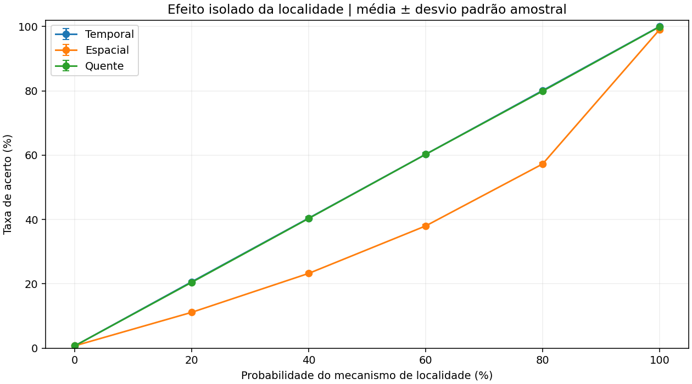
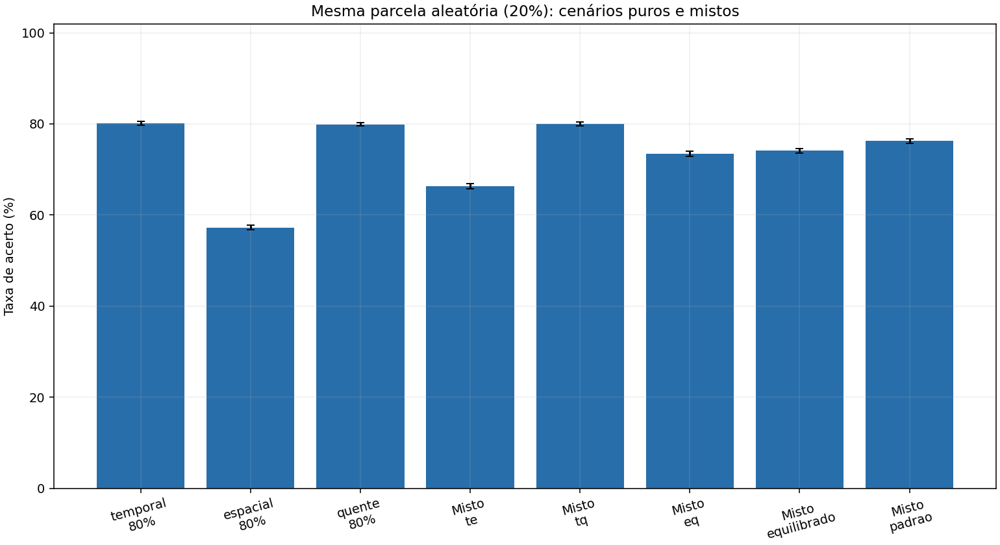
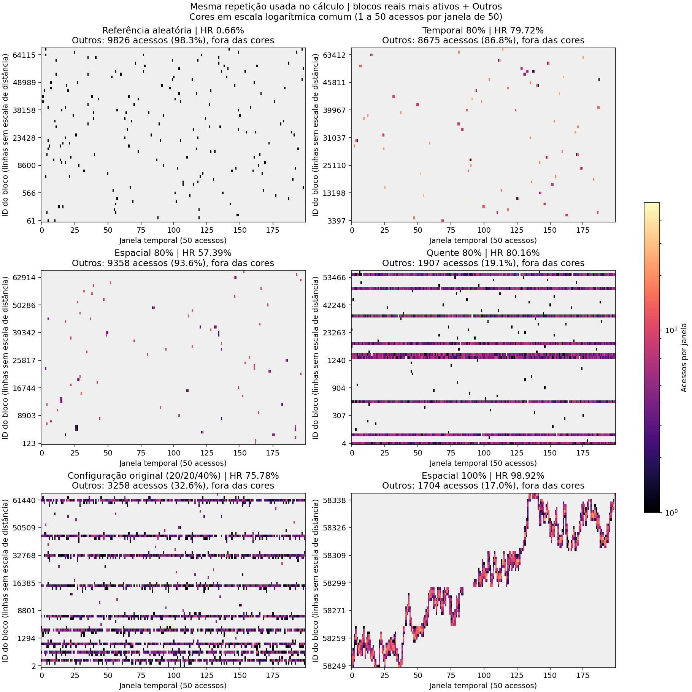
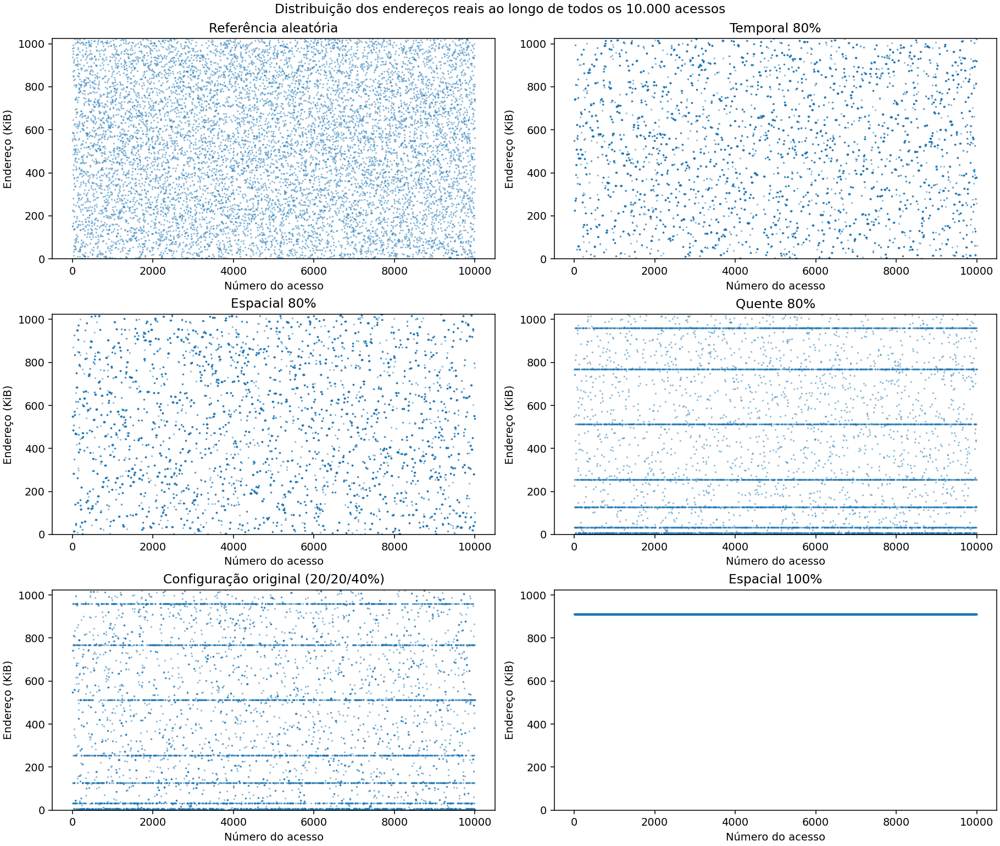

# Impacto da localidade temporal, espacial e de regiões quentes no desempenho da cache

Relatório do tópico 2 — Organização de Computadores — Engenharia da Computação.

Coleta original: **11 de novembro de 2026**. Reprodução na estrutura final: **13 de novembro de 2026**, horário de São Paulo. As métricas da coleta original foram preservadas. Identificação dos integrantes, turma e demais dados acadêmicos devem ser acrescentados pelo grupo antes da entrega.

## 1. Objetivo

Investigar como mudanças no padrão de acesso à memória alteram a taxa de acerto da cache. Foram variadas as probabilidades `prob_temporal`, `prob_espacial` e `prob_quente` do gerador fornecido, mantendo a arquitetura e a política de substituição constantes. Mapas de calor e gráficos de endereços ao longo dos acessos foram utilizados para relacionar as cargas geradas ao desempenho observado.

O estudo atende às três tarefas do tópico 2 do enunciado: variar os parâmetros de localidade, observar a taxa de acerto e correlacionar o padrão de acesso com sua visualização temporal por blocos.

## 2. Modelo e conceitos

**Localidade temporal** é o reaproveitamento de um dado recentemente utilizado. No gerador, esse mecanismo repete exatamente o endereço anterior. Após o primeiro carregamento, uma repetição imediata encontra o bloco na cache, pois nenhum outro acesso ocorre entre as duas referências.

**Localidade espacial** significa acessar dados próximos. O gerador sorteia um deslocamento inteiro uniforme entre -16 e +16 bytes, incluindo zero, e limita o resultado à faixa da memória. Esse mecanismo pode reutilizar o bloco atual, mas também pode acessar um bloco vizinho ainda ausente. Não é uma varredura sequencial: com probabilidade espacial de 100%, o gerador faz uma caminhada aleatória em passos curtos.

**Regiões quentes** concentram referências em um conjunto fixo de endereços. O modelo escolhe uniformemente uma das nove bases abaixo e um deslocamento entre zero e três bytes:

```text
64, 1024, 8192, 32768, 131072, 262144, 524288, 786432, 983040
```

Com blocos de 16 bytes, cada região de quatro endereços ocupa um único bloco. Assim, as nove regiões correspondem a apenas nove blocos. O mecanismo quente também produz reutilização temporal e espacial; os nomes dos ramos do gerador não tornam esses fenômenos fisicamente exclusivos.

O gerador seleciona os mecanismos por intervalos cumulativos de um sorteio uniforme. Portanto:

```text
p_aleatoria = 1 - (p_temporal + p_espacial + p_quente)
```

Cada probabilidade deve pertencer a [0, 1] e a soma deve ser no máximo 1. A variável experimental é a probabilidade de selecionar cada mecanismo, não a proporção exata de hits nem a proporção exata de endereços repetidos. Um acesso aleatório também pode, por coincidência, repetir um endereço já conhecido.

A métrica adotada foi:

```text
Hit rate = hits / (hits + misses)
```

## 3. Preparação e correções

O simulador original já implementava cache por conjuntos e políticas FIFO, LRU, LFU e Random. Um núcleo independente foi extraído para `atividade-2/scripts/cache_core.py`, mantendo as regras de substituição, para permitir testes e experimentos sem abrir a interface. A estrutura segue o padrão da atividade 6 do grupo: scripts, testes, resultados, gráficos, mapas e relatório dentro da pasta da atividade. **Os quatro arquivos originais da raiz permanecem inalterados**; nenhuma integração com a GUI é necessária para executar o estudo.

No núcleo experimental, foram acrescentadas validações de probabilidades e arquitetura e introduzido um gerador aleatório local com semente. Essas mudanças evitam configurações inválidas e permitem reproduzir os resultados. As dependências próprias ficam em `atividade-2/requirements.txt`; não é necessário instalar as dependências da GUI para este experimento.

O mapa original gerava uma nova sequência, limitava a visualização a 2.000 acessos e calculava a linha com `(endereco // bloco_tamanho) % 64`. Esse módulo fazia blocos reais diferentes compartilharem a mesma linha. Por exemplo, com blocos de 16 bytes, os blocos 0 e 64 eram desenhados juntos. Uma figura produzida dessa forma poderia sugerir concentração inexistente e não representava a sequência usada no cálculo da taxa de acerto.

Nos scripts da atividade, o mapa usa a mesma sequência da simulação, preserva todos os acessos e a última janela parcial e conta por identificador real de bloco. Para manter as figuras legíveis, são selecionados os 63 blocos mais ativos quando há mais de 64 blocos distintos. Os acessos restantes são contados em `Outros`. A rotina original da GUI foi preservada, com suas limitações, e não é usada para produzir as figuras desta entrega.

Nos gráficos do experimento, `Outros` não entra nas cores de um bloco individual e sua quantidade aparece no título. A posição das linhas selecionadas não mede distância física. Foi acrescentado um gráfico de endereço real ao longo do tempo para complementar essa limitação.

## 4. Metodologia experimental

### 4.1 Configuração fixa

| Parâmetro | Valor |
|---|---:|
| Memória principal | 1.048.576 bytes (1 MiB) |
| Capacidade da cache | 8.192 bytes (8 KiB) |
| Tamanho do bloco | 16 bytes |
| Linhas da cache | 512 |
| Associatividade | 16 vias |
| Número de conjuntos | 32 |
| Política de substituição | LRU |
| Acessos por repetição | 10.000 |
| Repetições por cenário | 30 |
| Estado inicial | Cache vazia em cada repetição |
| Janela do heatmap | 50 acessos, 200 janelas por trace |

Não foi removido um período de aquecimento: os misses iniciais fazem parte das métricas. Manter o bloco fixo é importante porque seu tamanho influencia diretamente o aproveitamento da localidade espacial. O estudo não compara políticas de substituição ou arquiteturas.

### 4.2 Cenários

Foram usados 21 cenários: uma referência totalmente aleatória; cinco probabilidades para cada mecanismo isolado (20%, 40%, 60%, 80% e 100%, com as demais zeradas); e cinco combinações mistas. O ponto de 0% é a mesma referência aleatória nas três curvas.

Nos cenários mistos, a soma das probabilidades de localidade é 80%, deixando 20% para o ramo aleatório. Isso permite comparar misturas com os casos puros de 80% sem alterar a parcela aleatória. Os cenários mistos são comparações adicionais: como variam mais de uma probabilidade, não isolam individualmente seus efeitos.

Foram usados objetos `random.Random(seed)` com sementes inteiras de **20261111 a 20261140**. A repetição de mesmo índice recebe a mesma identificação de semente em todos os cenários. Isso não significa que os cenários tenham a mesma sequência de endereços: cada ramo consome sorteios diferentes. A política LRU é determinística para uma sequência fixa.

### 4.3 Testes e critério para executar a coleta

Na coleta original, passaram 13 testes unitários do núcleo. Após a reorganização, a suíte passou a ter **15 testes**, incluindo comparação de cada hit/miss LRU e de cada endereço gerado com o simulador original nos 21 cenários. Antes de repetir a coleta definitiva, foi repetido um piloto de três repetições por cenário: **63 ensaios e 630.000 acessos**. O piloto precisava satisfazer sete verificações:

1. Hits mais misses iguais a 10.000 em cada ensaio.
2. Taxas no intervalo [0, 1].
3. Temporal 100% com exatamente um miss.
4. Quente 100% com exatamente nove misses.
5. Média aleatória entre 0,2% e 2%, faixa de plausibilidade para esta arquitetura.
6. Média espacial 100% acima de 90%.
7. Médias das três curvas isoladas crescentes com a probabilidade.

Todos passaram e a coleta definitiva foi autorizada pela condição estabelecida pelo usuário. A execução completa repetiu os testes, verificou o piloto e os hashes dos arquivos usados e executou **21 × 30 = 630 ensaios**, totalizando **6.300.000 acessos**. Os mesmos sete critérios passaram novamente.

A GUI não é parte da validação da entrega reorganizada: o simulador da raiz foi mantido intacto e os scripts usam Matplotlib com backend `Agg`, sem precisar de display, CustomTkinter ou Tcl/Tk. Um teste da GUI havia sido feito no protótipo anterior; esse protótipo foi preservado separadamente e não precisa entrar no commit da atividade 2.

### 4.4 Estatística e arquivos

O resumo usa a média aritmética e o **desvio padrão amostral** das 30 taxas, com divisor n-1. Nas tabelas, a média está em porcentagem e o desvio padrão em pontos percentuais (p.p.). As barras de erro representam um desvio padrão, não um intervalo de confiança. O Monte Carlo original da GUI imprime desvio populacional; as tabelas deste relatório usam o cálculo amostral do experimento.

`resultados/completo/execucoes.csv` contém cada resultado individual, probabilidades, semente, contadores, blocos distintos e hash da sequência. `resumo.csv` inclui médias, desvios, mínimos e máximos. `metadados.json` registra ambiente, configuração, hash da base original e hashes dos scripts. Para cada cenário, foi salvo o trace completo da primeira repetição com endereço, bloco e hit/miss. As outras sequências podem ser regeneradas com o código e as sementes registrados. As figuras ficam separadas em `graficos/` e `mapas_calor/`.

## 5. Resultados

### 5.1 Mecanismos isolados

| Probabilidade do mecanismo | Temporal: média (%) | DP (p.p.) | Espacial: média (%) | DP (p.p.) | Quente: média (%) | DP (p.p.) |
|---:|---:|---:|---:|---:|---:|---:|
| 0% | 0,755 | 0,085 | 0,755 | 0,085 | 0,755 | 0,085 |
| 20% | 20,664 | 0,340 | 11,163 | 0,290 | 20,498 | 0,408 |
| 40% | 40,436 | 0,527 | 23,261 | 0,353 | 40,338 | 0,504 |
| 60% | 60,274 | 0,513 | 38,008 | 0,522 | 60,255 | 0,580 |
| 80% | 80,087 | 0,421 | 57,265 | 0,457 | 79,907 | 0,405 |
| 100% | 99,990 | 0,000 | 99,018 | 0,212 | 99,910 | 0,000 |



O desvio zero nos extremos temporal e quente significa que os contadores foram iguais nas 30 execuções. Não significa ausência de aleatoriedade na geração dos endereços.

### 5.2 Misturas com 20% de acessos pelo ramo aleatório

| Cenário | Temporal | Espacial | Quente | Média (%) | DP (p.p.) |
|---|---:|---:|---:|---:|---:|
| Temporal puro | 80% | 0% | 0% | 80,087 | 0,421 |
| Espacial puro | 0% | 80% | 0% | 57,265 | 0,457 |
| Quente puro | 0% | 0% | 80% | 79,907 | 0,405 |
| Temporal + espacial | 40% | 40% | 0% | 66,287 | 0,539 |
| Temporal + quente | 40% | 0% | 40% | 79,947 | 0,432 |
| Espacial + quente | 0% | 40% | 40% | 73,404 | 0,568 |
| Equilibrado | 26,666…% | 26,666…% | 26,666…% | 74,126 | 0,498 |
| Configuração original | 20% | 20% | 40% | 76,261 | 0,514 |



Os números completos, sem o arredondamento de apresentação, estão em [resumo.csv](../resultados/completo/resumo.csv).

## 6. Discussão

### 6.1 Referência aleatória

A média foi **0,755%**, com DP de **0,085 p.p.** A cache possui 512 linhas para 65.536 blocos de memória, uma fração de **0,78125%**. Em acessos uniformes e independentes, essa razão fornece uma referência aproximada de hit rate após ocupação da cache. O valor medido é coerente com essa ordem de grandeza, considerando cache inicialmente vazia e variação entre ensaios.

Essa carga tem pouca reutilização previsível: os acessos se distribuem pela memória, e grande parte encontra blocos ausentes. A aproximação capacidade/memória não foi usada para preencher resultados; serve apenas para verificar sua plausibilidade.

### 6.2 Localidade temporal

A taxa cresceu aproximadamente com a probabilidade de repetição. Com 80% temporal, a média foi **80,087%**. Com 100%, o primeiro acesso foi um miss e os 9.999 seguintes foram hits em todas as repetições:

```text
9.999 / 10.000 = 99,99%
```

O resultado extremo coincide exatamente com a previsão do modelo. Pequenas diferenças entre a probabilidade e a taxa observada nos demais casos decorrem da realização aleatória dos ramos e de acertos adicionais do ramo aleatório.

### 6.3 Localidade espacial

A média chegou a **57,265% com 80% espacial**, abaixo das médias temporal e quente para a mesma probabilidade. O bloco tem 16 bytes e o deslocamento pode atingir 16 bytes em ambos os sentidos. Portanto, escolher o ramo espacial não garante permanecer no bloco já carregado. Os 20% de acessos aleatórios também interrompem as sequências locais e iniciam exploração em outras regiões.

Com 100% espacial, a taxa subiu para **99,018%**, com DP de **0,212 p.p.** Sem saltos aleatórios, a caminhada tende a revisitar uma faixa pequena comparada ao espaço total de memória. A cache pode conservar boa parte desse conjunto de trabalho. Ainda há misses de primeiro contato e pode haver substituições; por isso o resultado não é exatamente 100%. A contagem por tipos de miss não foi implementada, então não se atribuiu numericamente cada miss a uma causa.

Não se conclui que a localidade espacial seja inferior em geral. Seu benefício depende do tamanho do bloco, dos deslocamentos, dos saltos e do tamanho do conjunto de trabalho. Aqui o bloco foi mantido fixo para estudar apenas as probabilidades.

### 6.4 Regiões quentes

Com 80% quente, a média foi **79,907%**. Com 100%, foram **nove misses e 9.991 hits por ensaio**, resultando em **99,91%**. As nove regiões cabem na cache e não excedem a capacidade de nenhum conjunto nesta configuração de 16 vias.

Após a carga inicial, não entram novos blocos quando a probabilidade quente é 100%. Esse comportamento explica a ausência de variação na taxa extrema, embora a ordem de escolha das regiões seja aleatória. Os resultados altos dependem de regiões muito pequenas e fixas; regiões maiores, móveis ou com outros conflitos podem gerar comportamento diferente.

### 6.5 Combinações

Mesmo mantendo 20% de acessos pelo ramo aleatório, as taxas variaram de **57,265% a 80,087%** nos cenários comparados. A composição dos outros 80% importa. Temporal + quente atingiu **79,947%**, enquanto temporal + espacial atingiu **66,287%**. A configuração original de 20% temporal, 20% espacial e 40% quente atingiu **76,261%**.

As taxas das misturas não são obtidas simplesmente somando probabilidades ou fazendo média das taxas puras: cada acesso modifica a cache e o endereço anterior que influenciará os seguintes. As diferenças pequenas entre temporal puro, quente puro e temporal + quente não sustentam uma superioridade geral; não foi realizado teste formal de significância entre esses casos.

## 7. Relação com os mapas de calor



Cada célula representa o número de acessos a um bloco real em uma janela de 50 acessos. A escala de cores é logarítmica e comum a todas as figuras, de 1 a 50; o fundo claro representa zero. O hit rate do título é o da **primeira repetição**, não a média das 30. Por isso seus valores podem diferir dos da tabela.

Na referência aleatória, as ocorrências são esparsas. Com 80% temporal, surgem células mais intensas correspondentes à repetição de endereços em intervalos curtos. Com regiões quentes, aparecem faixas persistentes nos blocos frequentemente acessados. Na mistura original, essas faixas convivem com exploração de outros blocos. Com espacial 100%, a atividade percorre uma faixa restrita, com revisitas visíveis ao longo das janelas.

Nos casos com muitos blocos distintos, o recorte dos mais ativos deixa grande parte da carga em `Outros`. Por exemplo, no trace aleatório mostrado, **98,26% dos acessos** estão fora das linhas coloridas. Portanto, o painel não deve ser interpretado como cobertura integral da memória. A quantidade omitida é explicitada em cada título e continua contabilizada nas métricas e na matriz de contagens.



A Figura 4 preserva a escala física da memória e mostra todos os 10.000 pontos de cada trace selecionado. As regiões quentes aparecem em posições fixas; a caminhada espacial de 100% fica restrita a uma faixa pequena, visualmente quase horizontal nessa escala global. Nos casos temporal e espacial de 80%, a sobreposição de pontos e a escala global ocultam detalhes; esses padrões devem ser lidos junto aos mapas e às métricas.

Os gráficos mostram a carga de acesso, não o conteúdo interno da cache. A correlação visual ajuda a interpretar os resultados, mas a classificação de hit ou miss é feita pelo simulador e registrada nos traces.

## 8. Auditoria e reprodutibilidade

Uma auditoria separada recalculou as médias e os desvios dos 21 cenários a partir dos 630 registros. Também reexecutou os 21 traces representativos (**210.000 acessos**), comparando cada hit/miss, os IDs dos blocos, limites e hashes SHA-256. A soma das contagens de cada heatmap coincidiu com 10.000. Os 63 ensaios do piloto coincidiram exatamente com as primeiras três repetições da coleta completa.

O arquivo [auditoria.json](../resultados/completo/auditoria.json) registra a aprovação. Os [testes do núcleo](../resultados/completo/testes.txt) e a [validação da coleta](../resultados/completo/validacao.json) estão incluídos. As instruções de reprodução estão no [README](../README.md), e as decisões e problemas do ambiente no [registro de execução](../documentacao/REGISTRO_DE_EXECUCAO.md). A reorganização também comparou todos os CSVs numéricos e traces com a coleta de 11/11: eles permaneceram idênticos.

## 9. Limitações e implicações práticas

O experimento trabalha com cargas sintéticas, uma arquitetura fixa e política LRU. Não representa tempos reais da RAM ou da cache, hierarquias multinível, prefetch, custo de ciclos ou efeitos de escrita. A taxa de acerto é a única métrica de desempenho estudada; não foi calculado ganho de tempo de execução.

Os mecanismos do gerador simplificam programas reais. Repetir somente o último endereço é uma forma restrita de localidade temporal; as regiões quentes ocupam apenas nove blocos; a caminhada espacial pode reutilizar intensamente uma região pequena. Os resultados não devem ser generalizados para todas as cargas ou processadores.

Como implicações conceituais, os resultados favorecem reaproveitar dados enquanto estão na cache, processar dados próximos em sequência e organizar o trabalho em conjuntos que caibam na cache. Exemplos são reutilizar dados em laços e trabalhar com blocos de uma matriz. Essas recomendações ilustram os conceitos; tais programas não foram medidos neste estudo.

## 10. Conclusão

Para a configuração estudada, aumentar a probabilidade de cada mecanismo isolado elevou a taxa média de acerto. O cenário aleatório obteve **0,755%**, enquanto os extremos temporal, espacial e quente obtiveram **99,990%**, **99,018%** e **99,910%**, respectivamente. Os extremos temporal e quente coincidiram com as previsões exatas de um e nove misses.

Com probabilidade de 80%, temporal e quente ficaram próximos de 80% de acertos, enquanto espacial ficou em 57,265%, evidenciando o efeito dos cruzamentos de bloco e das interrupções aleatórias no modelo adotado. Os mapas de calor, associados às sequências efetivamente simuladas, mostraram como repetição, proximidade e concentração sustentam a reutilização. Os testes, a aprovação do piloto, os dados brutos e a auditoria documentam a confiabilidade e os limites dessas observações.

## Referências do trabalho

- Material da disciplina: `Projeto - Simulador cache.pdf`, tópico 2, página 1.
- Manual fornecido: `README_Simulador_Memoria_Cache.pdf`, especialmente geração dos padrões, Monte Carlo, reprodutibilidade e princípio de variar um parâmetro por vez.
- Simulador Python e licença MIT fornecidos com o projeto, copyright 2025 de jpauloo-git.
- Dados desta execução: [resumo](../resultados/completo/resumo.csv), [execuções individuais](../resultados/completo/execucoes.csv) e [metadados](../resultados/completo/metadados.json).
